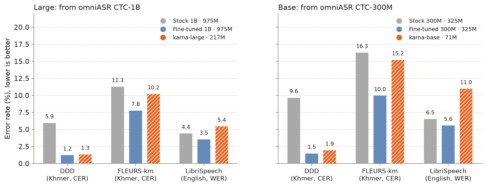
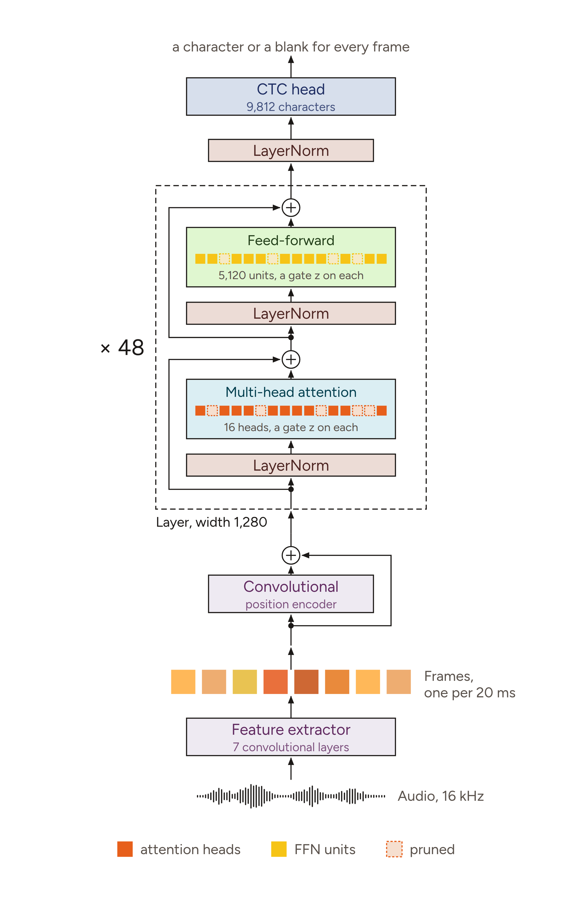
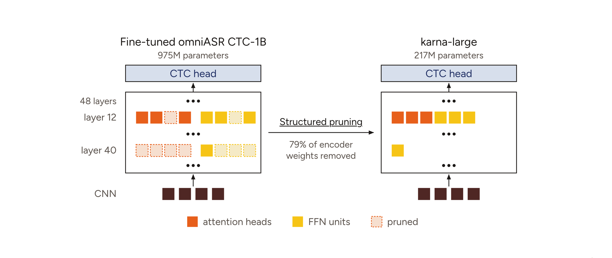
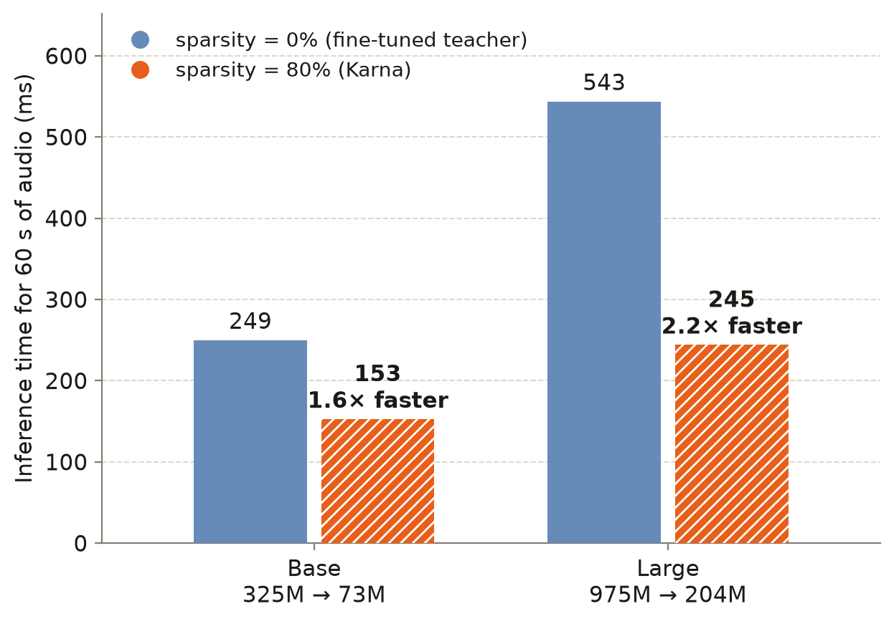

<div align="center">
  
  
</div>

<hr>

<p align="center">
  <a href="https://github.com/netra-ai-lab/Karna"><b>GitHub</b></a> |
  <a href="https://github.com/netra-ai-lab/Karna/pkgs/container/karna"><b>Docker Image</b></a> |
  <a href="https://pypi.org/project/netra-karna/"><b>PyPI</b></a> |
  <a href="https://huggingface.co/Netra-Lab/karna-base"><b>Karna-base</b></a> |
  <a href="https://huggingface.co/Netra-Lab/karna-large"><b>Karna-large</b></a> |
  <a href="https://huggingface.co/Darayut/omniASR-CTC-1B-km-en"><b>Fine-tuned 1B</b></a> |
  <a href="https://huggingface.co/Darayut/omniASR-CTC-300M-km-en"><b>Fine-tuned 300M</b></a> |
  <a href="https://huggingface.co/datasets/Digital-Divide-Data/khmer-speech-dataset"><b>Khmer Dataset</b></a>
</p>

<p align="center">
  
  
  <a href="https://huggingface.co/Netra-Lab/karna-base"></a>
  <a href="https://pypi.org/project/netra-karna/"></a>
  <a href="https://github.com/netra-ai-lab/Karna/pkgs/container/karna"></a>
  
</p>

<h2>
<p align="center">
  Karna: Structured Pruning of Omnilingual ASR for Khmer and English
</p>
</h2>

<p align="center">
  Khmer and English speech in, text out. Two compact models, 71M and 217M parameters, pruned from Meta's Omnilingual ASR.
</p>

<p align="center">
  
</p>

<p align="center">
  <em>Test error for each size: the stock Omnilingual model, our fine-tuned teacher and the pruned Karna model. Lower is better. On DDD, the pruned models beat both larger models; on LibriSpeech they keep 1.7–1.9× the teacher's error.</em>
</p>

## 1. Abstract

This repository presents Karna, a pair of **71M- and 217M-parameter** CTC speech recognisers for Khmer and English. They are built by structurally pruning Meta's Omnilingual ASR CTC models (`omniASR_CTC_300M` and `omniASR_CTC_1B`) to **about 80% encoder sparsity**. The recipe follows *Fine-tune Before Structured Pruning*:
1. The full model is fine-tuned on the target languages.
2. Hard Concrete L0 gates remove attention heads and FFN units while the model is distilled to that fine-tuned teacher.
3. The pruned model recovers with CTC plus distillation of the teacher's output distribution.

On the DDD test set, the 217M model reaches **1.33% CER**, against 1.22% for its 975M teacher and 5.95% for the stock 1B, at a quarter of the compute (12.9 against 50.3 GMAC per second of audio). The 71M model reaches **1.94% CER**, against its 325M teacher's 1.47%, at 5.8 GMAC/s. These are the v2 models; the first release and what changed are in [docs/RESULTS.md](docs/RESULTS.md).

## 2. Dataset

Karna was trained on about **2,034 hours** of speech, mixed 50/50 between Khmer and English by audio seconds. FLEURS is fixed at 20% of each language's audio and repeated as needed.

### Sources

| Dataset | Type | Size | Domains |
| :--- | :--- | ---: | :--- |
| [DDD Khmer Speech](https://huggingface.co/datasets/Digital-Divide-Data/khmer-speech-dataset) | Khmer speech | 1,058 h | Cambodian culture, 61 topics, native speakers |
| [FLEURS](https://huggingface.co/datasets/google/fleurs) km_kh train | Khmer read speech | 7.1 h | Wikipedia sentences |
| [LibriSpeech](https://www.openslr.org/12) train-clean-100 + 360 + other-500 | English read speech | 961 h | Audiobooks |
| [FLEURS](https://huggingface.co/datasets/google/fleurs) en_us train | English read speech | 7.5 h | Wikipedia sentences |
| **Total** | | **2,034 h** | |

### Preprocessing

1. **Held-out sets.** The DDD test set, a DDD dev pool and an exclude list are removed from DDD training at the shard-row level.
2. **Duration filter.** Utterances shorter than 1 s or longer than 25 s are dropped.
3. **Resampling.** Audio is resampled to 16 kHz mono, which affects some 48 kHz DDD rows.
4. **Text normalisation.**
   - NFC, with zero-width characters removed and whitespace collapsed; English is lowercased.
   - Text is filtered to the Omnilingual character vocabulary, which has no Khmer punctuation such as `។`. This drops 1.2% of DDD characters.
5. **Loudness normalisation.** Each utterance is normalised to zero mean and unit variance, as in Omnilingual ASR.

## 3. Model Architecture

<p align="center">
  
</p>

<p><em>Figure 1: The model, reading upwards, with one transformer layer opened up: 16 kHz audio, a feature extractor of 7 convolutional layers giving one frame every 20 ms, a convolutional position encoder added back to the frames, 48 pre-LayerNorm transformer layers of width 1,280, a final LayerNorm and a CTC head over 9,812 characters. Every attention head and every FFN unit has its own Hard Concrete gate z. The cells in the opened layer are layer 12 of karna-large: 11 of 16 heads and 3,788 of 5,120 FFN units kept; which ones are kept is schematic.</em></p>

**The base model.** A wav2vec2-style encoder:
- a 7-layer CNN feature extractor (20 ms frames);
- a convolutional position encoder;
- pre-LayerNorm transformer layers;
- a linear CTC head over Omnilingual's 9,812-character vocabulary.

**What pruning removes.** Each encoder layer keeps only the attention heads and FFN units that the L0 gates leave open, so every layer has its own width. The model dimension, the CNN front end and the CTC head stay intact.

<p align="center">
  
</p>

<p><em>Figure 2: Structured pruning removes whole attention heads (MHA) and FFN units from every transformer layer, chosen by one Hard Concrete gate each; the CNN front end is kept. Each cell is a quarter of a layer's heads or FFN units: layer 12 of karna-large keeps 11 of 16 heads and 3,788 of 5,120 FFN units, and layer 40 keeps no heads and 264 FFN units. Training runs in five steps: fine-tune, prune, cut, distil with the mask frozen, and recover with CTC and logit distillation ([docs/DESIGN.md](docs/DESIGN.md)).</em></p>

<p align="center">
  
</p>

<p><em>Figure 3: Inference time before and after pruning, for one 60 s utterance (batch 1, bf16, median of 20 runs on one machine; `training/scripts/07_time_inference.py`). At about 80% encoder sparsity karna-base runs 1.6× faster than its teacher and karna-large 2.2× faster. Over the batched test sets (the Speed column below) the speed-ups are 1.8× and 2.4×.</em></p>

| Feature | Detail |
| :--- | :--- |
| Pruned units | Attention heads and FFN intermediate units (Hard Concrete L0 gates) |
| Sparsity control | Augmented Lagrangian; target ramps 0 → 80% over the first 50% of Stage 2 |
| Distillation | L1 − cosine on hidden states at 5 layers (Stages 2 and 2b); frame-level KL on outputs (Stage 3) |
| Decoding | Greedy CTC by default; CTC beam search with a character 8-gram language model when one is given (`KARNA_LM`, `--lm`) |

| Hyperparameter | karna-base | karna-large |
| :--- | ---: | ---: |
| Pruned from | omniASR CTC-300M | omniASR CTC-1B |
| Encoder layers × model dim | 24 × 1024 | 48 × 1280 |
| Heads kept (of 384 / 768) | 91 | 198 |
| FFN units kept (of 98,304 / 245,760) | 11,740 | 41,045 |
| Encoder sparsity | 80.6% | 78.7% |
| Stage 1 / 2 / 2b / 3 steps | 62k / 12k / 5k / 24k | 62k / 12k / 5k / 24k |
| Compute (GMAC / s of audio) | 5.8 | 12.9 |
| Total parameters | 71M | 217M |

## 4. Evaluation

| Model | Params | Speed | DDD (CER) | FLEURS-km (CER) | LibriSpeech (WER) |
| :--- | ---: | ---: | ---: | ---: | ---: |
| omniASR CTC-1B (stock) | 975M | 1.0× | 5.95 | 11.26 | 4.40 |
| Fine-tuned 1B (teacher) | 975M | 1.0× | 1.22 | 7.77 | 3.54 |
| **karna-large (ours)** | **217M** | **2.4×** | **1.33** | **10.20** | **5.44** |
| omniASR CTC-300M (stock) | 325M | 1.0× | 9.65 | 16.26 | 6.53 |
| Fine-tuned 300M (teacher) | 325M | 1.0× | 1.47 | 9.95 | 5.57 |
| **karna-base (ours)** | **71M** | **1.8×** | **1.94** | **15.20** | **10.96** |

- **Scoring.** Greedy decoding, error rates in %, on the full test sets:

  | Test set | Utterances |
  | :--- | ---: |
  | DDD | 1,993 |
  | FLEURS-km | 771 |
  | LibriSpeech test-clean | 2,620 |

- **Speed.** Inference speed relative to the unpruned model of the same size, measured as the real-time factor on one machine.
- **In-domain.** FLEURS-km train is in the training mix, so its test set is in-domain.
- **Teachers.** The teachers here are the v2 fine-tuned models (a full pass over the training mix). The teachers on Hugging Face are still the first release's, which score 2.47 (1B) and 3.68 (300M) on DDD.
- **More results.** [docs/RESULTS.md](docs/RESULTS.md) adds FLEURS-en and LibriSpeech test-other, the first release against v2, and the ablations behind the recipe: pruning without fine-tuning first, and Stage 3 without distillation or with a shorter schedule.

## 5. Quick start

The quickest way in is the Docker image: a web app and REST API with both models inside.

1. Install [Docker Desktop](https://www.docker.com/products/docker-desktop/) for Windows, Mac or Linux. In its settings, give it at least 6 GB of memory (2 GB is enough if you only use karna-base).
2. Open a terminal (PowerShell on Windows, Terminal on Mac) and run:

   ```bash
   docker run -d --name karna -p 8000:8000 -v karna-data:/data ghcr.io/netra-ai-lab/karna
   ```

3. Open http://localhost:8000. Drop an audio file on the page, or record from the microphone.

> **The page won't open?** The app needs port 8000, which `-p 8000:8000` sets up. If you start the image from Docker Desktop's *Images* tab instead, open *Optional settings* and set *Host port* to `8000`. The models load in the background for the first few seconds, and the header says *Ready* once they have.

| | |
| :--- | :--- |
| Platforms | Windows and Linux PCs (x86-64) and ARM64, including Apple Silicon Macs |
| GPU | Not needed; runs on the CPU |
| Download | About 1.2 GB (1.4 GB unpacked), both models included |
| Memory | About 0.5 GB idle, 1.7 GB with karna-base in use, 4 GB with both models in use |
| Speed | karna-base 8.7 s and karna-large 17.0 s per minute of audio (16-thread AMD Zen 3 laptop CPU, batch 8) |
| Internet | Not needed after the download. Audio never leaves your computer. |
| Input | wav, flac, ogg or mp3 of Khmer or English speech, up to 1 hour per file (longer than 30 s is split at pauses) |
| Output | Lowercase text without punctuation, as txt or json |

**Python package.** For scripts and pipelines, install from PyPI. Inference runs on [ONNX Runtime](https://onnxruntime.ai), so PyTorch isn't needed.

```bash
pip install "netra-karna[cpu]"          # or [gpu] for CUDA, [full] for the web app too
```

| Extra | Adds |
| --- | --- |
| *(none)* | The `karna` library and command: numpy, soundfile, soxr, huggingface_hub. Add one runtime below. |
| `cpu` | ONNX Runtime for the CPU |
| `gpu` | ONNX Runtime with CUDA (instead of `cpu`) |
| `server` | The web app and REST API (`karna serve`): fastapi, uvicorn |
| `full` | `cpu` and `server` |

The first run downloads the ONNX model from [Hugging Face](https://huggingface.co/Netra-Lab/karna-base) and caches it under `~/.cache/huggingface` (`HF_HOME`): karna-base is 287 MB and karna-large 871 MB. `karna download` fetches them ahead of time, for offline use.

## 6. Usage

**Python.** Two lines to a transcript. Load a model once, then transcribe files, arrays or batches of either.

```python
import karna

asr = karna.load_model("karna-base")              # or "karna-large", a Hugging Face id, a local folder
print(asr.transcribe("speech.wav"))             # one file -> one string
print(asr.transcribe(["a.wav", "b.flac"]))      # a list -> a list, batched
print(asr.transcribe((waveform, 44100)))        # a numpy array with its sample rate
print(asr.transcribe("speech.wav", language="km"))  # Khmer only: never Latin letters ("en", default "auto")

live = asr.stream()                             # live: feed 16 kHz chunks as they arrive
for event in live.feed(chunk):                  # partial text, then final text per utterance
    print(event["type"], event["text"])
```

**Command line.** Each file prints as one line: the path, a tab, then the text.

```bash
karna transcribe speech.wav other.flac --model karna-large    # --language auto|km|en, --format txt|json, --device cpu|cuda
karna models                                                  # list the released models
karna download karna-base karna-large                         # fetch now, run offline later
karna serve --port 8000                                       # the web app and REST API ([server] extra)
```

**REST API.** Upload, then poll, or wait for the text in one call. Interactive docs are at `http://localhost:8000/docs`.

```bash
curl -F file=@speech.wav "http://localhost:8000/v1/transcribe?wait=true"           # the finished job, with result.text
curl -F file=@speech.wav -F model=karna-large -F language=km http://localhost:8000/v1/transcribe  # -> 202, the queued job
curl http://localhost:8000/v1/jobs/<id>                                            # until "status": "done"
curl -o speech.txt "http://localhost:8000/v1/jobs/<id>/export?format=txt"          # or json
```

**Live.** The web app's **Live captions** show text as you speak. Each utterance gets its own line, which turns white from the front as successive drafts agree; only the last few seconds stay grey, and **Settled only** hides those. Behind it, the `/v1/stream` WebSocket takes 16 kHz PCM frames and sends back partial and final text. Each utterance is decoded again as it grows, and the session is saved as a job when you stop. For Khmer, choose karna-large and **ខ្មែរ**. **Microphone** switches the browser's noise suppression between Filtered (on) and Raw (off). See [docs/USAGE.md](docs/USAGE.md#live-transcription-v1stream).

| Setting | Default | Meaning |
| :--- | :--- | :--- |
| `KARNA_API_KEY` | *(unset)* | Require `X-API-Key` / `Authorization: Bearer` on `/v1/*`. Set it before exposing the port beyond your machine. |
| `KARNA_MODEL` | `karna-base` | The model loaded at start; the other loads on first use |
| `KARNA_MAX_SECONDS` | `3600` | Longer audio is refused with HTTP 422; audio over 30 s is split at pauses |
| `KARNA_LM` | *(unset)* | A character language model (`.npz`) for beam search; see [docs/USAGE.md](docs/USAGE.md#decoding) |
| `KARNA_CACHE_DIR` | `~/.cache/karna` | Where each model's copy with a language input is kept (made on first load: 0.3 GB base, 0.9 GB large) |

[docs/USAGE.md](docs/USAGE.md) lists every flag, route, environment variable and device.

**Train it yourself.** One script runs the whole recipe: data, conversion, fine-tune, prune, distil, recover, evaluate and export to ONNX. It resumes where it stopped. Training is a separate package in `training/`, with PyTorch.

```bash
pip install -e . -e training                       # or: bash training/setup.sh
cp training/local.env.example training/local.env   # point it at your data
training/run.sh base                               # or: training/run.sh large
```

| Reference | |
| --- | --- |
| [Usage](docs/USAGE.md) | Python API, CLI flags, REST routes, environment variables, devices |
| [Training](docs/TRAINING.md) | `run.sh` step by step, data layout, environment variables, checkpoints and resuming |
| [Design](docs/DESIGN.md) | The pruning recipe, each decision and how it departs from DiariZen, the code map |
| [Results](docs/RESULTS.md) | All test and dev numbers, the ablations, the pruning run step by step |
| [Releasing](docs/RELEASING.md) | Exporting to ONNX, uploading, PyPI and Docker releases |

## 7. Limitations

- **English is the weak side.** Pruning to about 80% costs English far more than Khmer, at 1.5–2× the teacher's WER. Use `karna-large`, or a fine-tuned teacher, when English accuracy matters.
- **No punctuation or casing.** Output is lowercase with no punctuation, because the Omnilingual character vocabulary has no Khmer punctuation.
- **The language model isn't shipped.** Beam search with a character language model lowered error on nearly every real-world proxy, for example karna-base OpenSLR Khmer CER 11.3 → 8.5 and karna-large test-other WER 13.3 → 11.0 ([docs/RESULTS.md](docs/RESULTS.md#8-real-world-proxies-inference-only-2026-11-26)), but the model is built from local text corpora (`scripts/build_char_lm.py`) and isn't published yet. Without one, Karna decodes greedily. `language` only limits which characters can be written; English from a microphone is still weak.
- **Long files are split at pauses.** Training used clips of 1–25 s, so files over 30 s are cut at pauses (as in live transcription), each piece decoded with 1 s of the previous one as context. A cut inside a word can still cost a few characters.
- **Two languages only.** The models were trained and tested on Khmer and English only; other languages Omnilingual supports will have degraded.
- **The Khmer corpus is a manual download.** [DDD](https://huggingface.co/datasets/Digital-Divide-Data/khmer-speech-dataset) is public, but `training/run.sh` doesn't fetch it, and it reads DDD through its own shard index (see [docs/TRAINING.md](docs/TRAINING.md)).

## 8. Licensing

This project is released under the Apache License 2.0 (see [LICENSE](LICENSE)); [THIRD_PARTY_LICENSES.md](THIRD_PARTY_LICENSES.md) lists what it builds on.
- **Weights:** derived from Meta's Omnilingual ASR CTC models, released under Apache 2.0.
- **`training/karna_train/hardconcrete.py`:** ported from DiariZen, which is MIT-licensed.
- **Training data:** DDD is CC BY-SA 4.0 ([Digital Divide Data](https://huggingface.co/datasets/Digital-Divide-Data/khmer-speech-dataset)), LibriSpeech is CC BY 4.0, and FLEURS is CC BY 4.0.

## References

1. **Omnilingual ASR: Open-Source Multilingual Speech Recognition for 1600+ Languages**  
   *Omnilingual ASR team, Meta AI*  
   2025.  
   [facebookresearch/omnilingual-asr](https://github.com/facebookresearch/omnilingual-asr)

2. **Fine-tune Before Structured Pruning: Towards Compact and Accurate Self-Supervised Models for Speaker Diarization**  
   *Jiangyu Han et al.*  
   Interspeech 2025.  
   [arXiv:2505.24111](https://arxiv.org/abs/2505.24111)

3. **Efficient and Generalizable Speaker Diarization via Structured Pruning of Self-Supervised Models**  
   *Jiangyu Han et al.*  
   2025.  
   [arXiv:2506.18623](https://arxiv.org/abs/2506.18623)

4. **DPHuBERT: Joint Distillation and Pruning of Self-Supervised Speech Models**  
   *Yifan Peng, Yui Sudo, Shakeel Muhammad, Shinji Watanabe*  
   Interspeech 2023.  
   [arXiv:2305.17651](https://arxiv.org/abs/2305.17651)

5. **Learning Sparse Neural Networks through L0 Regularization**  
   *Christos Louizos, Max Welling, Diederik P. Kingma*  
   ICLR 2018.  
   [arXiv:1712.01312](https://arxiv.org/abs/1712.01312)

6. **FLEURS: Few-shot Learning Evaluation of Universal Representations of Speech**  
   *Alexis Conneau et al.*  
   SLT 2022.  
   [arXiv:2205.12446](https://arxiv.org/abs/2205.12446)

7. **LibriSpeech: an ASR corpus based on public domain audio books**  
   *Vassil Panayotov, Guoguo Chen, Daniel Povey, Sanjeev Khudanpur*  
   ICASSP 2015.  
   [OpenSLR 12](https://www.openslr.org/12)

8. **Khmer ASR Cultural Dataset**  
   *Digital Divide Data*  
   Hugging Face Datasets.  
   [Digital-Divide-Data/khmer-speech-dataset](https://huggingface.co/datasets/Digital-Divide-Data/khmer-speech-dataset)
